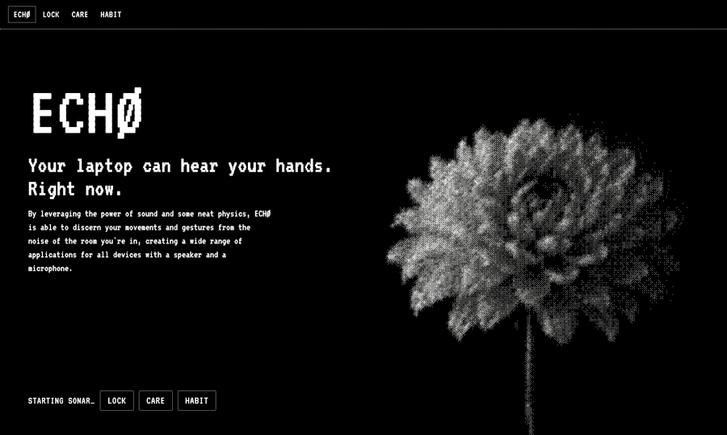
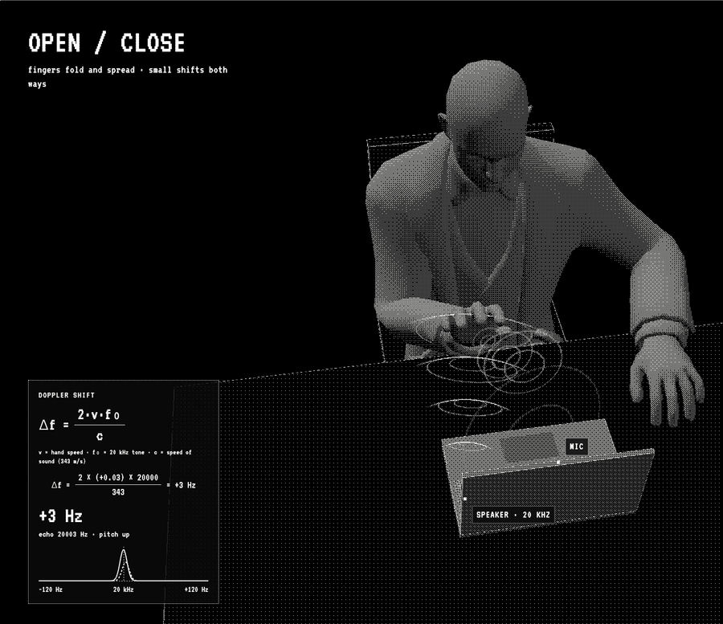
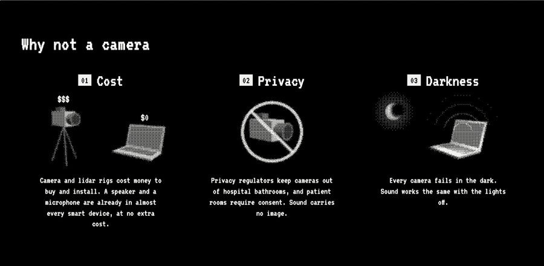
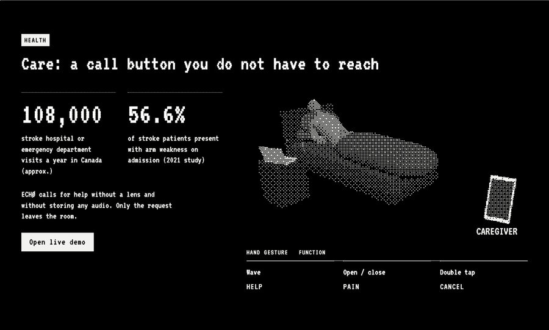
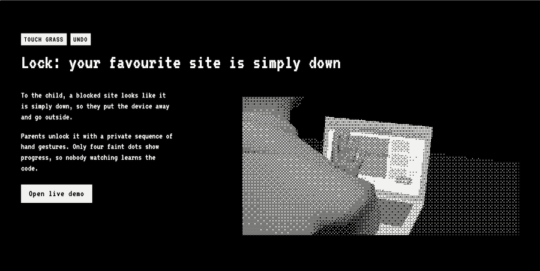
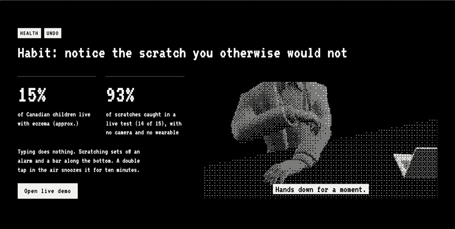
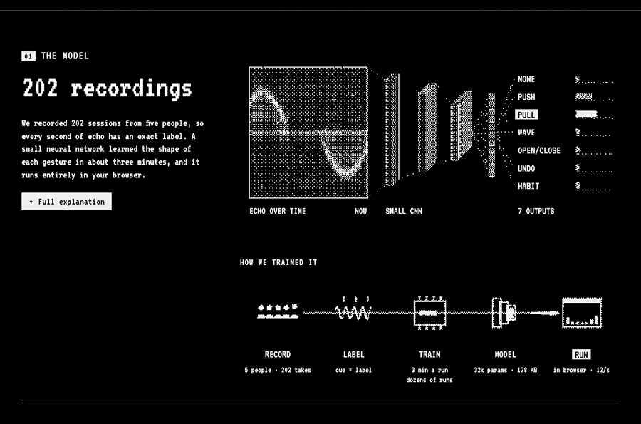
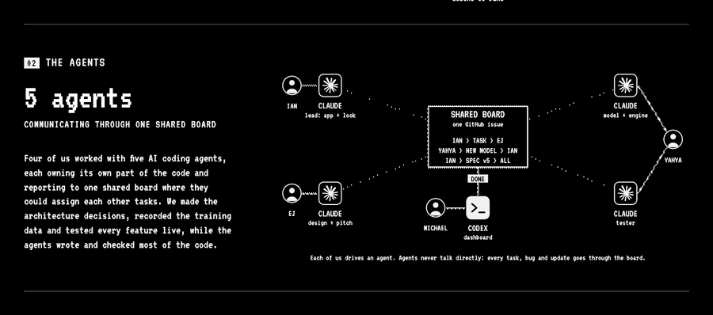
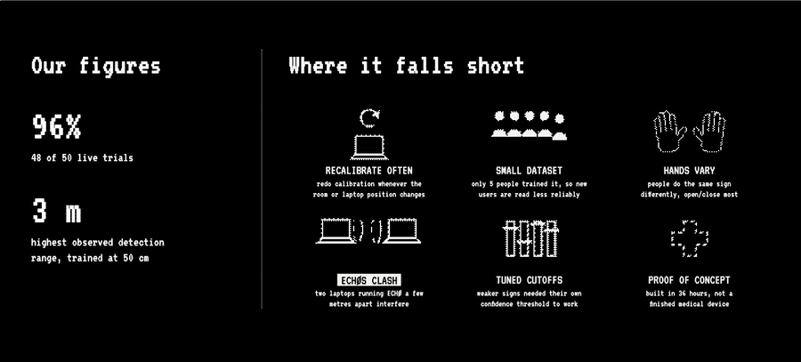
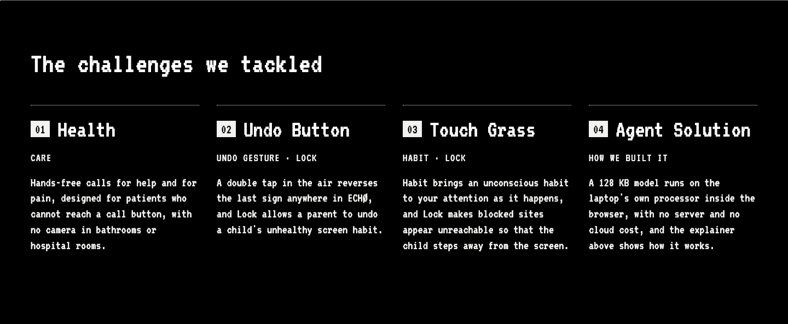

<p align="center">
  
</p>

<h1 align="center">ECHØ</h1>

<p align="center">
  <b>Your laptop can hear your hands.</b><br>
  Touch-free gesture control from the speaker and microphone already in your laptop.<br>
  No camera, no extra hardware, and no audio ever stored.
</p>

<p align="center">
  <a href="https://echo-codejam16.vercel.app"><b>Live site</b></a> ·
  <a href="#how-it-works">How it works</a> ·
  <a href="#three-apps">Three apps</a> ·
  <a href="#our-figures">Our figures</a> ·
  <a href="#run-it-yourself">Run it</a> ·
  <a href="#team">Team</a>
</p>

---

ECHØ plays a 20 kHz tone that most adults cannot hear and listens to its echo. When your hand moves, the echo shifts in pitch, and a small neural network running in your browser reads that shift as a gesture. We built it at **McGill CodeJam 16** to show that the hardware for touch-free control is already in almost every laptop, that it can work where cameras are not allowed, and that it can help people who cannot reach a button.

## How it works

<p align="center"></p>

1. **The speaker plays a steady 20 kHz tone.**
2. **Your hand reflects it back to the microphone.** Moving toward the screen raises the echo's pitch, moving away lowers it, and a still hand gives no shift at all. This is the Doppler effect, $\Delta f = 2 v f_0 / c$.
3. **A small CNN reads one second of the echo spectrogram** and decides which gesture it saw, about twelve times a second, entirely on the laptop.
4. **Calibration** learns what your room sounds like when nothing moves, so only your hand stands out.

## Why not a camera

<p align="center"></p>

Camera and lidar rigs cost money to buy and install, privacy rules keep cameras out of hospital bathrooms and require consent in patient rooms, and ordinary cameras need light to see. A speaker and a microphone are already in almost every smart device, they work in the dark, and they never capture an image of anyone.

## Three apps

All three share one gesture: a **double tap in the air is undo**.

### Care: a call button you do not have to reach
<p align="center"></p>

For patients who can move a hand but cannot reach a call button. A stroke often causes weakness on one side of the body, and a 2021 study found that 56.6% of stroke patients had arm weakness on admission.

| Hand gesture | Function |
|---|---|
| Wave | Help |
| Open / close | Pain |
| Double tap | Cancel |

### Lock: your favourite site is simply down
<p align="center"></p>

A Chrome extension makes blocked sites look exactly like Chrome's own "This site can't be reached" page, so a child has nothing to argue with. Parents unlock it with a private sequence of hand gestures, and only four faint dots show progress, so nobody watching learns the code.

### Habit: notice the scratch you otherwise would not
<p align="center"></p>

About 15% of Canadian children live with eczema, where scratching that you do not notice keeps the skin from healing. Habit ignores typing, gives a gentle prompt when it hears scratching, and a double tap snoozes it for ten minutes.

## How we built it

<p align="center"></p>

| | |
|---|---|
| **Data** | 202 recordings from 5 people, labelled by on-screen cues, 134k training windows |
| **Input** | 1 second of echo, 48 × 87 Doppler bins around 20 kHz |
| **Model** | Small CNN, 3 conv blocks, 7 outputs, about 32k parameters, 128 KB |
| **Training** | PyTorch on one laptop GPU, about 3 minutes a run, dozens of runs |
| **Testing** | Every general score is on a person the model never saw |
| **Runs** | In the browser with onnxruntime-web, on the laptop CPU, about 12 times a second |

<p align="center"></p>

Four of us worked with **five AI coding agents**, each owning its own part of the code and coordinating through one shared GitHub issue that acted as a message board. Agents assigned each other tasks and checked each other's work, while we made the architecture decisions, recorded the training data and tested every feature live. Over the weekend the board carried 480 messages, and the repo grew to 379 commits and 29 issues. The full setup is in [docs/TEAM_SETUP.md](docs/TEAM_SETUP.md).

## Our figures

<p align="center"></p>

- **96%** of gestures recognised live (48 of 50 trials) on our calibrated demo MacBook Pro.
- **3 m** highest observed detection range, although we only trained up to 50 cm.
- **14 of 15** scratches caught in a live Habit test, with no camera and no wearable.

ECHØ is a proof of concept and not a finished medical device. It needs recalibrating whenever the room or the laptop position changes, it was trained on only five people, the same sign varies from person to person, two laptops running ECHØ a few metres apart can interfere, and each gesture needed its own tuned threshold.

## Run it yourself

The fastest way is the [live site](https://echo-codejam16.vercel.app) in Chrome. Allow the microphone, set the volume to about 70%, and keep your hands still for the first few seconds while it calibrates.

To run it locally you need a recent version of Node (20 or newer).

```bash
git clone https://github.com/I-ala-Wilson/codejam16.git
cd codejam16/app
npm install
npm run dev          # opens http://localhost:5173
```

**Lock** needs the Echo Lock extension: open `chrome://extensions`, turn on Developer mode, click **Load unpacked** and choose the `extension/` folder (or download it from the Lock page). **Care** sends events to the caregiver dashboard through Supabase if you copy `.env.example` to `.env` and fill in a project URL and publishable key; without it, events stay on the laptop.

## Repository

| Folder | What is in it |
|---|---|
| `app/` | The site and the three apps (React, TypeScript, Vite) |
| `engine/` | The sonar engine: tone, FFT, calibration and the in-browser classifier |
| `ml/` | Training, evaluation and the experiment log (PyTorch) |
| `extension/` | The Echo Lock Chrome extension |
| `dashboard/` | The caregiver dashboard |
| `data/recordings/` | The 266 labelled audio recordings we collected |
| `contracts/` | Shared interfaces between the parts |

## Team

<p align="center"></p>

<table align="center">
  <tr>
    <td align="center" width="25%"><a href="https://ianwilson.dev"><br><b>Ian Wilson</b></a><br><a href="https://ianwilson.dev">ianwilson.dev</a></td>
    <td align="center" width="25%"><a href="https://yahya-hallani.dev/"><br><b>Yahya Hallani</b></a><br><a href="https://yahya-hallani.dev/">yahya-hallani.dev</a></td>
    <td align="center" width="25%"><a href="https://www.linkedin.com/in/eunjunko/"><br><b>EJ Ko</b></a><br><a href="https://www.linkedin.com/in/eunjunko/">LinkedIn</a></td>
    <td align="center" width="25%"><a href="https://www.linkedin.com/in/michael-lulic-401b65234/"><br><b>Michael Lulic</b></a><br><a href="https://www.linkedin.com/in/michael-lulic-401b65234/">LinkedIn</a></td>
  </tr>
</table>

<p align="center"><sub>Built in one weekend at McGill CodeJam 16, November 2026.</sub></p>
