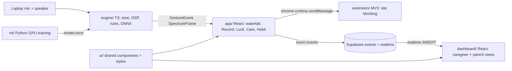

SPEC_VERSION: 6

# SPEC: Echo (sonar gesture engine, three apps)

> Only @I-ala-Wilson edits this file. Every change bumps SPEC_VERSION and is announced on the board. The why is in `docs/BRIEF.md`.

## 1. Problem and pitch
Your laptop can see your hands without a camera. The speaker plays an inaudible 20 kHz tone and the mic hears the Doppler shift of your hand's echo. There's no camera and no new hardware, no images are captured, and it works in the dark. One engine powers three apps:
- **Lock:** a gesture password for a kid's browser;
- **Care:** a camera-free help button and activity monitor;
- **Habit:** catches scratching or nail-biting.

See `docs/BRIEF.md`.

## 2. Challenge and tracks we target
| Track | What judges score | How we hit it |
|---|---|---|
| Health (primary) | Quality of life for people with illness/disability, creativity | Care: camera-free help gesture + inactivity alerts, privacy, works in the dark |
| Touch Grass / People First | Away from the phone, real-world interaction | Lock gets kids off the screen; parent sets a secret hand rhythm |
| Undo | Fix a mistake creatively | UNDO gesture in every app; "undo handing the kid the iPad"; Habit undoes habits |
| Agent | Is the project an agent | Pitch-only: our 4-agent build system |

## 3. Demo script (judging room, 2-4 judges, quiet)
1. Waterfall: a judge moves a hand; we tape over the webcam (~30 s).
2. Lock:
   - YouTube is blocked;
   - the judge fails 3 times, which triggers an alarm plus a parent alert on the dashboard;
   - we unlock with the secret 4-gesture rhythm (~60 s).
3. Care: a WAVE for help lights up the caregiver dashboard on a phone within 1 s, plus the inactivity alert and an activity timeline (~60 s).
4. Habit: fake scratching triggers a nudge chime and a log entry; UNDO snoozes it (~30 s).
5. Honesty slide: measured range and accuracy, and where it's worse than a camera (~30 s).

## 4. Scope
- **Must (Floor, Sat 12:00):**
  - engine with rule detectors PUSH/PULL/WAVE/HOLD/OPEN_CLOSE/UNDO;
  - live waterfall;
  - Record page;
  - Lock (app + extension);
  - Care help alert on the dashboard.
- **Should (Target, Sat 22:00), in this order:**
  1. calibration UX;
  2. Habit (REPETITIVE);
  3. inactivity + activity timeline;
  4. GPU-trained classifier in the browser (ONNX);
  5. measured accuracy/range report;
  6. style pass.
- **Moonshot:**
  1. two-tone swipe L/R.
- **Cut (v6):** ASL signs (Yahya's call, out of scope); breathing (pre-registered test failed twice, see ml/experiments/RESULTS.md).
- **Cut:**
  - mobile/iPad app;
  - real OS lock;
  - accounts/login;
  - full ASL.

## 5. Architecture

## 6. Stack and run commands
- **Language and build:** TypeScript everywhere in the browser; Vite + React for `app/` and `dashboard/`.
- **ML:** Python 3.11 + PyTorch (CUDA on Yahya's GPU) in `ml/`, exported to ONNX and run with onnxruntime-web.
- **Backend:** Supabase.
- **Env vars:** `.env` at the repo root, copied from `.env.example`. Never commit it.
  - `VITE_SUPABASE_URL`, `VITE_SUPABASE_ANON_KEY`, `VITE_EXTENSION_ID`, `VITE_DEVICE_ID`.

| Lane | Run |
|---|---|
| app | `cd app && npm i && npm run dev` → http://localhost:5173 (open in Chrome, allow the mic) |
| dashboard | `cd dashboard && npm i && npm run dev` → http://localhost:5174 |
| extension | chrome://extensions → Developer mode → Load unpacked → `extension/` |
| engine | imported by app via the `@engine` alias; `cd engine && npm i && npm run typecheck` |
| ml | `cd ml && python -m venv .venv && . .venv/bin/activate && pip install -r requirements.txt && python check_gpu.py` |
| backend | paste `backend/schema.sql` into the Supabase SQL editor (Michael's project) |

## 7. Contracts
See `contracts/`:
- `engine.ts`: the Engine API and GestureEvent / SpectrumFrame;
- `events.md`: the events table and realtime;
- `extension.md`: the LOCK/UNLOCK/STATUS messages;
- `recording.md`: WAV + JSON session files.

## 8. Lanes and ownership
| Lane | Owner | Folder(s) | Budget | Depends on |
|---|---|---|---|---|
| Engine + ML | Yahya-github | `engine/*`, `ml/*` | high (GPU) | contracts |
| App + extension + integration + demo | I-ala-Wilson | `app/*`, `extension/*`, shared files | high | engine, backend, ui |
| Backend + dashboard | Miguel982 (Michael) | `backend/*`, `dashboard/*` | low (Codex) | events contract |
| UI kit + pitch | EJ2007 | `ui/*`, `pitch/*` | low (Pro, Sonnet) | none |
| QA | Yahya-github/qa | `qa/*`, `docs/qa/*` | high | everything |

## 9. Milestones (Montreal time)
| Milestone | Deadline | Done when |
|---|---|---|
| Room test (humans) | Fri 21:30 | tone + push/pull checked on all 4 laptops in the hall; demo laptop chosen |
| M1 skeleton | Fri 23:30 | live waterfall in the app; Record page saves a session; a test event reaches the dashboard; extension loads and blocks a site |
| Recording session (humans) | Fri 23:45 | each person: every gesture ×20 |
| QA M1 | Fri 23:50 | QA pass |
| Sleep | 00:00–08:00 | everyone |
| M2 Floor | Sat 12:00 | every Must item demos end to end |
| QA M2 | Sat 12:30 | full pass |
| Target | Sat 22:00 | Should items |
| Nightly QA | Sat 23:30 | full pass before sleep |
| Freeze | Sun 09:00 | demo-path fixes only |
| **HARD CUTOFF** | **Sun 11:30** | **last commit AND last push. Anything pushed at/after 12:00 disqualifies us. Git hooks block commits and pushes from 11:30** |
| Submit | ⚠️ confirm on the Discord | Devpost, video, repo public |
| Final QA | 1 h before submit | 3 clean demo runs |
| Judging | Sun 13:00–15:30 | |
| Closing | Sun 16:30 | one of us present for the prize cheque |

## Changes
- v5 (Fri 23:30): HARD CUTOFF Sun 22 Nov 11:30 Montreal: no commits or pushes after it (hooks enforce; pushing at 12:00+ = disqualified).
- v4 (Fri 22:28): UNDO is a DOUBLE TAP TOWARD: two quick small taps toward the screen within ~600 ms (contracts/engine.ts). Replaces v3's flick away.
- v2 (Fri 22:10): recordings are 16-bit WAV committed to `data/recordings/<login>/` (contracts/recording.md); Record page added to app.

## 10. Open questions
- The submission deadline and Devpost requirements (video length?): confirm on the Discord.
- The product name ("Echo" is a working name).
- The UI style (decided Saturday; `ui/` starts neutral black/white).
